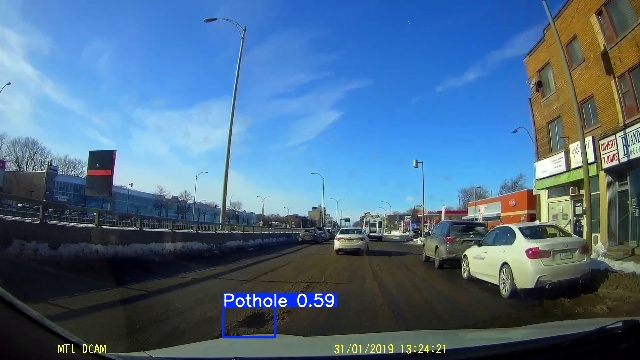
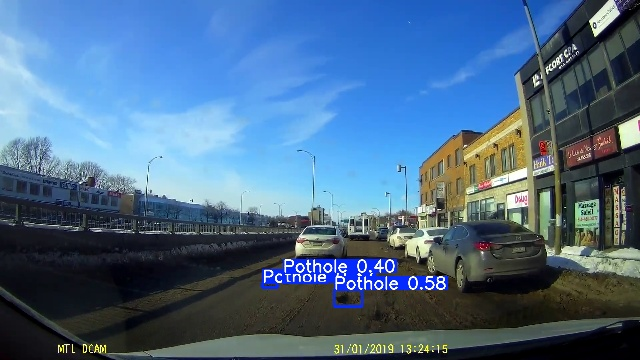
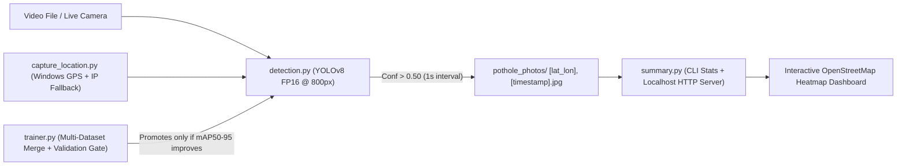
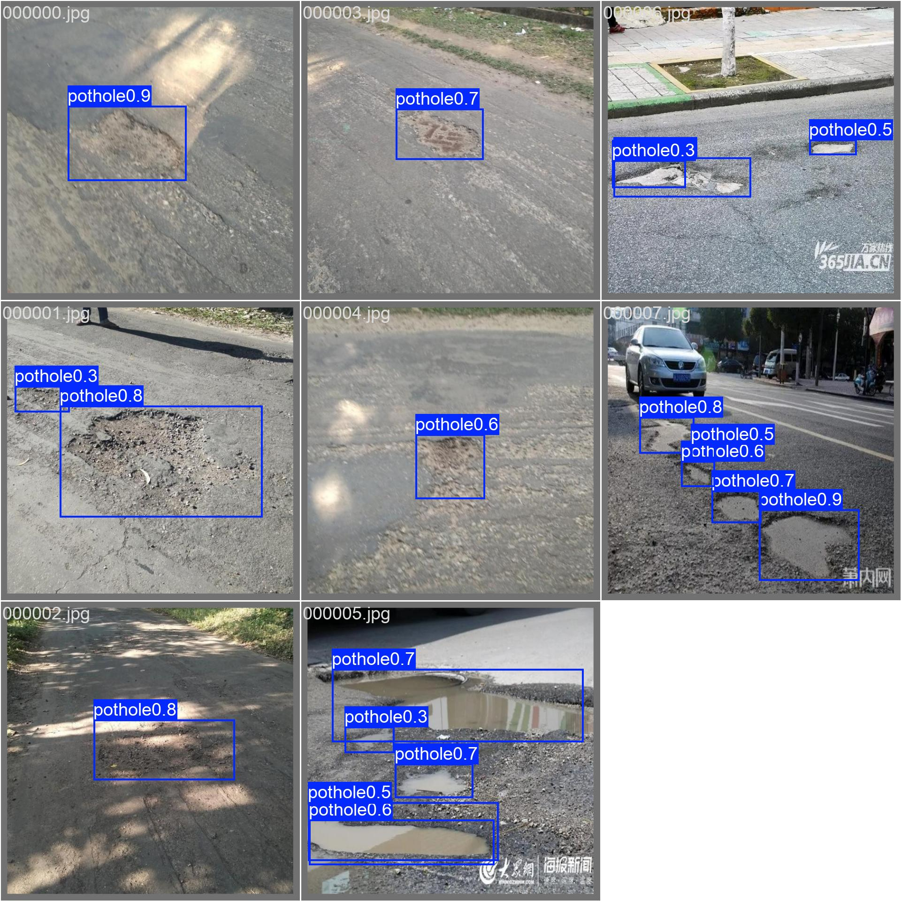
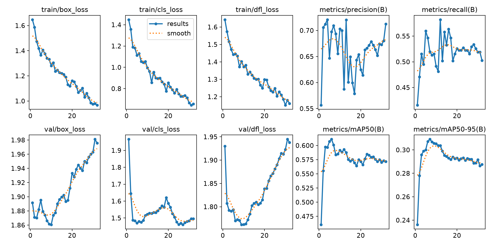

# FroggerCV — Real-Time Road Pothole Detection, Geotagging & Heatmap Analytics

FroggerCV is an end-to-end computer vision pipeline that detects road potholes in dashcam video and live camera streams using **YOLOv8**, automatically geotags high-confidence captures with **GPS coordinates and local timestamps**, and generates an interactive **Heatmap dashboard**.

<p align="center">
  
  
</p>

---

## How It Works



1. **Stream Ingestion & Real-Time Sync (`detection.py`)**: Reads frames from a video file (`pothole1.mp4`, `pothole2.mp4`) or a live camera (`0`), pacing playback to real-time wall-clock timestamps and dropping lagging frames so live previews never fall behind.
2. **YOLOv8 FP16 Inference (`models/pothole.pt`)**: Runs the road-trained [Samdutse/pothole-yolov8](https://huggingface.co/Samdutse/pothole-yolov8) YOLOv8s detector at `800px` resolution with half-precision (`fp16`) quantization and draws bounding boxes above `CONFIDENCE = 0.35`.
3. **Automatic Geotagged Evidence Capture (`capture_location.py`)**: Tracks device coordinates in the background via Windows `.NET GeoCoordinateWatcher` (with automatic IP geolocation fallback when hardware GPS is unavailable) and saves frames with detections above `PHOTO_CONFIDENCE = 0.50` every `1.0` second to `pothole_photos/`.
4. **Hotspot Summarization & Interactive Heatmap (`summary.py`)**: Parses every saved capture filename, aggregates daily counts and ~11-meter spatial hotspots, writes `pothole_photos/heatmap.html`, and serves it over `http://localhost` with a Material 3 split-screen analytics view, OpenStreetMap tiles, and a click-to-preview modal dialog.
5. **Multi-Dataset Fine-Tuning (`trainer.py`)**: Downloads and merges multiple Hugging Face pothole datasets (`390` images, `1,000` annotated pothole instances) plus optional negative background frames (`data/negatives/`), fine-tunes YOLOv8, and only replaces `models/pothole.pt` if validation box `mAP50–95` improves.

---

## Results & Visual Examples

### 1. Validation Set Predictions (`105` validation images, `291` pothole instances)



| Checkpoint | Precision | Recall | Box mAP50 | Box mAP50–95 | Status |
| :--- | :---: | :---: | :---: | :---: | :--- |
| **Active (`models/pothole.pt` — Samdutse YOLOv8s)** | `0.649` | `0.584` | `0.6130` | **`0.3180`** | Active default (`highest mAP50–95`) |
| **Multi-Dataset Fine-Tuned (`runs/detect/pothole/weights/best.pt`)** | **`0.721` (+7.2%)** | `0.526` | `0.6028` | `0.3087` | Saved candidate (`highest precision`) |

### 2. Multi-Dataset Training Curves (`32` epochs on NVIDIA RTX A2000 GPU)



### 3. Training & Validation Console Output

<p align="center">
  
  
</p>

---

## Quick Start

### 1. Install (Python 3.12)

```powershell
py -3.12 -m venv .venv
.\.venv\Scripts\python.exe -m pip install -r requirements.txt
```

### 2. Download Model (`models/pothole.pt`) (OPTIONAL/model provided)

```powershell
.\.venv\Scripts\hf.exe download Samdutse/pothole-yolov8 best.pt --local-dir models
Move-Item -Force models\best.pt models\pothole.pt
```

### 3. Run

```powershell
# Detect potholes in video/webcam (press 'q' to quit)
.\.venv\Scripts\python.exe detection.py

# View summary stats + interactive OpenStreetMap heatmap
.\.venv\Scripts\python.exe summary.py

# Train / fine-tune on merged datasets (use --device 0 for NVIDIA GPU)
.\.venv\Scripts\python.exe trainer.py --device 0

# Run unit tests
.\.venv\Scripts\python.exe -m unittest discover -v
```

> **Tip**: Set `VIDEO_PATH = 0` in `detection.py` to use your live webcam instead of `pothole1.mp4`. Enable **Windows Settings > Privacy & security > Location** for GPS tags on saved photos in `pothole_photos/`.

---

## Project Structure

```text
FroggerCV2/
├── detection.py          # Real-time YOLOv8 video/camera pothole detector
├── capture_location.py   # Background GPS + IP location tagger
├── summary.py            # CLI stats + interactive OpenStreetMap heatmap server
├── trainer.py            # Multi-dataset downloader, trainer & validation gate
├── document/             # Sample detection outputs & training plots
└── tests/                # Unit test suite (23 offline tests)
```

## Attribution

- **Model**: [Samdutse/pothole-yolov8](https://huggingface.co/Samdutse/pothole-yolov8)
- **Datasets**: [keremberke/pothole-segmentation](https://huggingface.co/datasets/keremberke/pothole-segmentation) (CC BY 4.0) & [Ryukijano/Pothole-detection-Yolov8](https://huggingface.co/datasets/Ryukijano/Pothole-detection-Yolov8)
